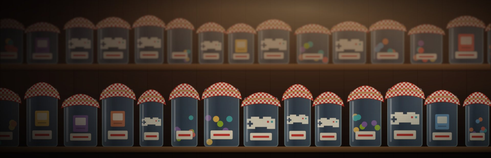
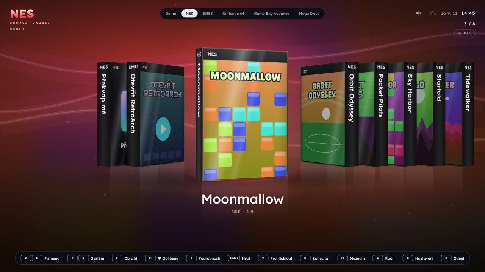
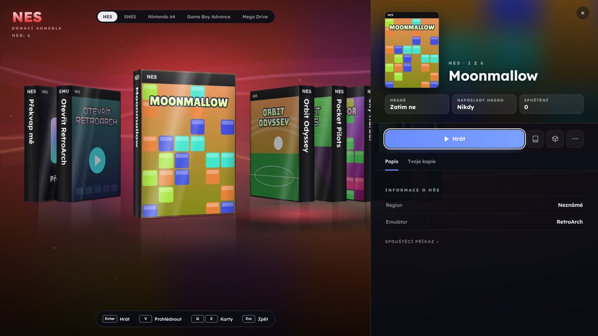
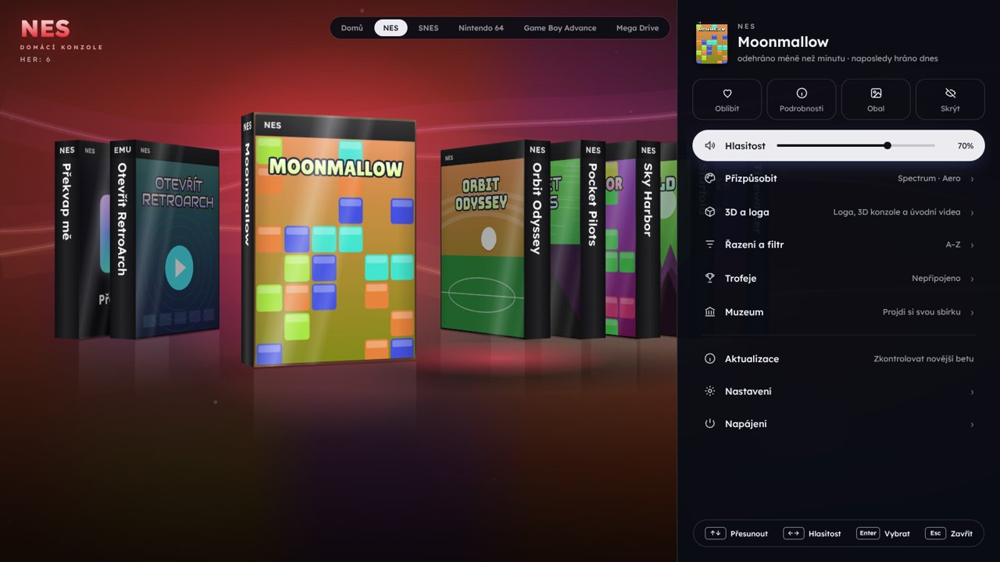
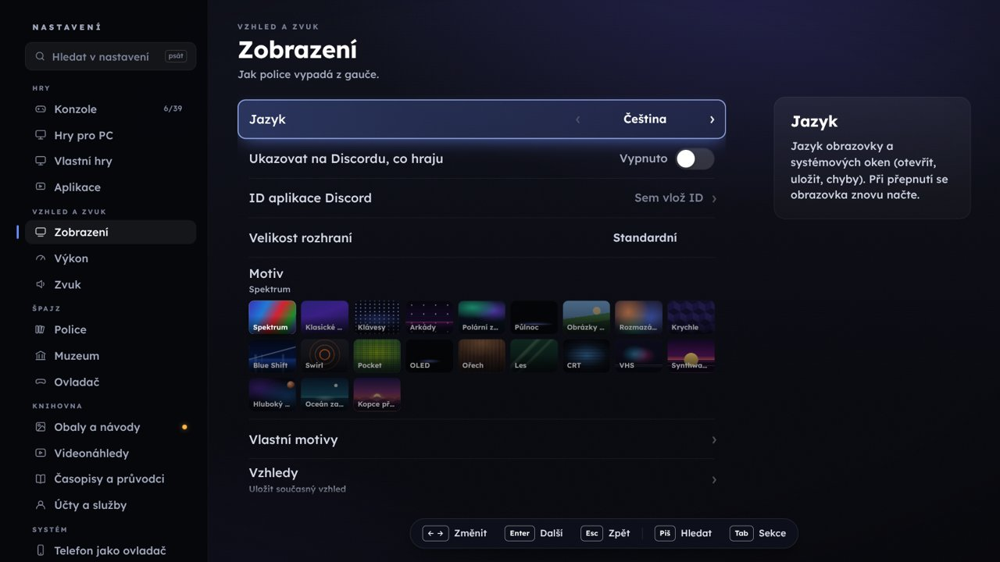

<h1 align="center">
  
</h1>

<p align="center"><b>Česká herní polička pro tvoje emulátory, Steam a Game Pass.</b><br>
Skutečné krabice her na 3D policích, návody ke čtení, achievementy a jeden ovladač na všechno.</p>

<p align="center"></p>


## Jak to vypadá

| Police | Podrobnosti hry |
|---|---|
|  |  |
| **Rychlé menu** | **Nastavení** |
|  |  |

## Stažení

Hotové verze najdeš na stránce [Releases](https://github.com/adamjeonline/spajz/releases):

- **Windows:** `Spajz-<verze>-windows.exe`. Dej ho do vlastní složky (vedle sebe si vytvoří složku `data`
  s nastavením) a spusť dvojklikem. Když Windows ukáže „Systém Windows ochránil váš počítač“, klikni na
  *Další informace → Přesto spustit* (program není digitálně podepsaný).
- **Linux a Steam Deck:** `Spajz-<verze>-linux.AppImage`. Povol spouštění (*Vlastnosti → Oprávnění → Je spustitelný*,
  nebo `chmod +x Spajz-*.AppImage`) a spusť. Nastavení se ukládá do `~/TrustyShelf`.

### Steam Deck (herní režim)

1. V režimu plochy dej AppImage třeba do `~/Applications/Spajz` a povol spouštění.
2. Ve Steamu: *Hry → Přidat hru mimo Steam → Procházet*, přepni filtr na „Všechny soubory“ a vyber AppImage.
   (Nebo nech Špajz, ať se do Steamu přidá sám: *Nastavení → Systém*.)
3. V herním režimu ho najdeš v *Knihovna → Mimo Steam*. V nastavení ovladače zvol šablonu **Gamepad**.
4. Hru ukončíš podržením **Select + Start**, nebo se v menu Steamu přepni na Špajz a dvakrát stiskni **B**.

## Sestavení ze zdrojového kódu

Potřebuješ [Node.js](https://nodejs.org) (LTS).

```
npm install
npm run dist:win      # Windows: dist/Spajz-<verze>-win-portable.exe
npm run dist:linux    # Linux:   dist/Spajz-<verze>-linux.AppImage
npm start             # spuštění bez sestavení
```

Překlad je ve složce `scripts/i18n/cs` (řádky `číslo|text` a `=anglický text|český text`). Po úpravě spusť
`python3 scripts/i18n/build_cs.py`.


Špajz neobsahuje žádné hry, BIOSy ani obaly: hraj jen to, co vlastníš.
